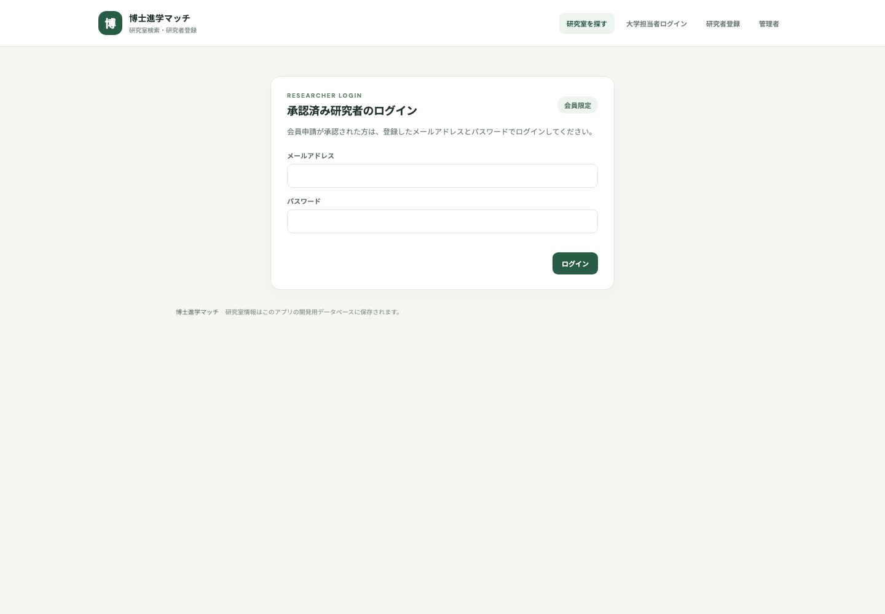
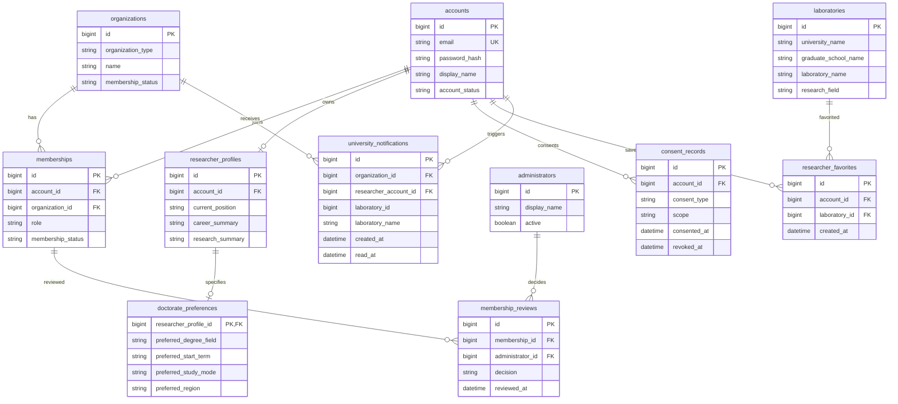
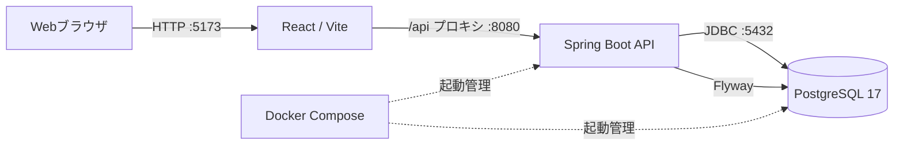

# 博士進学マッチ

### 博士号を目指す企業研究者と、研究テーマに合う大学院研究室との出会いを支援する。

## アプリケーション概要

大学・企業コンソーシアムの会員企業に所属する研究者と、会員大学の大学院研究室をつなぐWebアプリケーションです。研究室の研究内容や社会人受入条件を検索し、博士課程への進学希望者と大学担当者が、同意に基づいて関心情報を共有できます。

現段階では、研究室検索、研究者の会員申請・ログイン、研究室のお気に入り、大学担当者による研究室管理、お気に入り研究者の閲覧・通知を実装しています。相談申込、面談日程調整、正式な出願・入試は対象外です。

## 開発背景・目的

企業研究者が博士号取得を検討する際、研究テーマに合う指導研究室や、社会人としての受入条件をまとめて比較できる情報が限られています。研究室の情報収集や大学への初回連絡にも手間がかかります。

本アプリは、研究テーマ、受入条件、研究者の進学希望を同じ場所で確認できるようにし、候補探索と大学担当者への関心表明を支援することを目的に開発しています。コンソーシアム内の大学・企業間の人材交流や、博士人材育成に関する相談機会の拡大も目指しています。

## アプリケーションURL

- 本番環境: 未公開（ローカル開発環境）
- ソースコード: [GitHubリポジトリ](https://github.com/cozyn2026/Dr_matching_app)

## デモ画像



## 主な使用技術

| 領域 | 技術 |
|---|---|
| フロントエンド | React、JavaScript、Vite |
| API | Java 21、Spring Boot 4.0.9、Spring Web、Spring Data JPA、Spring JDBC、Spring Security、Bean Validation |
| データベース | PostgreSQL 17、Flyway |
| 開発環境 | Docker Compose |

## ER図

現行実装の主要テーブルと外部キー関係を示します。



## インフラ構成図



## ローカル環境での起動方法

DBとAPIをDocker Composeで起動します。

```sh
docker compose up --build -d db backend
```

フロントエンド（Node.js）:

```sh
cd frontend
npm install
npm run dev
```

画面: <http://localhost:5173>

API: <http://localhost:8080>

### 開発用アカウント

| ロール | メールアドレス | パスワード |
|---|---|---|
| 承認済み研究者 | `demo.researcher@example.com` | `LabMatch-Demo-2026!` |
| 東京大学担当者 | `demo.university@example.com` | `University-Demo-2026!` |

研究室サンプルと上記アカウントは開発専用の架空データです。研究者申請の審査APIは現在、開発用管理キー `DR_MATCHING_ADMIN_KEY`（未設定時の既定値: `local-admin-key-change-me`）で保護しています。今後は審査キー方式に代えて管理者アカウント機能を追加する予定です。
