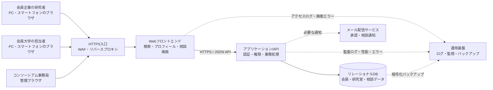

# 博士人材・大学院研究室マッチングアプリ システム構成設計

## 1. 目的と対象

本書は、会員企業の博士学位取得希望者と会員大学の大学院研究室をつなぐWebアプリの初期版について、構成要素とその役割を定める。現行モックアップにある研究室検索、詳細表示、お気に入り、相談申込み、相談状況確認、大学担当者による回答、事務局管理を対象とする。

この設計では、研究室候補の提示は条件検索で行う。自動推薦・適合度判定、正式な出願・入試、自由形式のチャット、決済、外部カレンダー連携は初期版に含めない。

## 2. 構成方針

- ブラウザ、Webアプリ/API、データベースの3層構成とする。
- 初期版は機能ごとに分割した単一のバックエンドアプリ（モジュラーモノリス）とする。運用と開発を単純に保ち、利用増加後に必要な部分だけ分離できる形にする。
- Web画面とAPIを分離し、画面はHTTPSでAPIを呼び出す。APIはJSON形式で入出力する。
- データはリレーショナルデータベースに保存する。研究者、大学担当者、事務局の権限確認はAPI側で必ず行う。
- 研究テーマや職歴は機微性の高い情報として扱い、最小限の公開とアクセス記録を基本とする。

## 3. システム構成図

## 4. 構成要素と責務

| 構成要素 | 主な責務 | 設計上の要点 |
|---|---|---|
| 利用者ブラウザ | 画面表示、入力、検索、相談操作 | PC・スマートフォン対応。入力チェックは補助とし、最終検証はAPIで行う |
| HTTPS入口 | TLS終端、リクエスト振り分け、基本的な攻撃遮断 | HTTPはHTTPSへ転送。公開するのはWeb/APIの入口のみ |
| Webフロントエンド | モックアップにある画面・ナビゲーション・フォームを提供 | 研究者、大学担当者、事務局で共通のWebアプリを使い、権限に応じて画面を表示する |
| アプリケーション/API | ログイン、認可、検索、プロフィール、相談状態遷移、事務局管理 | 初期版は単一アプリ内の機能モジュールとして実装。画面に隠した操作もAPI側で拒否する |
| リレーショナルDB | 業務データの永続化、関連付け、検索 | DBはインターネットから直接接続できないネットワークに配置。バックアップを暗号化する |
| メール配信サービス | 会員申請の結果や新しい相談の通知 | メール本文に研究テーマや相談内容を含めず、ログイン後に確認する案内を送る |
| 運用基盤 | アプリログ、監視、バックアップ、障害調査 | パスワード、相談本文、不要な個人情報をログに記録しない |

メール通知は初期版では任意構成とする。利用する場合は、通知の失敗で相談データが失われないよう、DBへの保存を先に完了させる。

## 5. アプリケーション内部モジュール

| モジュール | 処理内容 |
|---|---|
| 認証・会員管理 | ログイン、ログアウト、パスワード再設定、会員申請、事務局承認、利用停止 |
| 権限管理 | 研究者・大学担当者・事務局の権限確認、所属組織と担当研究室の確認 |
| 研究者プロフィール | 経歴、所属、研究テーマ、希望条件、公開同意と公開範囲の管理 |
| 研究室カタログ | 大学・研究科・研究室、研究分野、指導内容、社会人受入れ条件、公開状態の管理 |
| 研究室検索 | キーワード・分野・地域・通学形態・受入れ条件による検索。公開中の研究室のみ返す |
| お気に入り | 研究者ごとの研究室候補の登録・解除・一覧表示 |
| 相談管理 | 相談申込み、担当大学による受付・辞退、面談候補、状態履歴、一覧表示 |
| 事務局管理 | 会員承認、利用者停止、掲載内容の確認、問い合わせ対応、管理操作履歴 |

初期版の検索は登録された項目の一致・部分一致による絞り込みとする。研究者と研究室の「相性」や入学可能性を自動算出しない。

## 6. 主要なデータ構成

| エンティティ | 主な項目・関連 |
|---|---|
| 会員組織 | 組織ID、組織名、企業／大学区分、承認状態 |
| 利用者アカウント | 利用者ID、メールアドレス、パスワードハッシュ、役割、組織ID、状態 |
| 研究者プロフィール | 利用者ID、表示名、職歴、研究テーマ、専門分野、博士取得希望、公開範囲 |
| 研究室 | 研究室ID、大学組織ID、研究科、名称、指導教員、研究内容、公開状態 |
| 受入れ条件 | 研究室ID、社会人受入れ可否、指導形態、地域、受入れ状況、条件説明 |
| お気に入り | 研究者ID、研究室ID、登録日時。研究者と研究室の組み合わせは一意 |
| 相談 | 相談ID、研究者ID、研究室ID、相談本文、状態、作成・更新日時 |
| 相談履歴 | 相談ID、実行者ID、変更前後の状態、回答・面談候補、実行日時 |
| 同意記録 | 利用者ID、同意対象、公開範囲、同意日時、撤回日時 |
| 操作監査記録 | 実行者ID、操作種別、対象ID、日時、結果。秘密情報や相談本文は含めない |

相談状態の初期値は「申込済み」とする。状態は `申込済み → 大学確認中 → 面談調整中 → 面談済み → 完了` を基本とし、別経路として「辞退」「取消」を記録する。状態変更のたびに相談履歴を追加し、過去履歴を上書きしない。

## 7. 主要データフロー

### 7.1 研究室を探して相談する

1. 研究者がログインし、APIがアカウント状態と役割を確認する。
2. ブラウザが検索条件をAPIへ送る。APIは公開中の研究室だけをDBから取得し、一覧を返す。
3. 研究者が研究室詳細を確認し、お気に入り登録または相談申込みを行う。
4. 相談申込み時にAPIが必須項目、同意、対象研究室の受付状態を検証し、相談と初期状態をDBに保存する。
5. 大学担当者の画面には、自大学・担当研究室宛ての相談だけを表示する。
6. 大学担当者が回答すると、相談状態と履歴をDBに保存する。研究者は自分の申込み状況を確認できる。

### 7.2 会員申請・承認

1. 利用希望者が組織と利用者区分を添えて申請する。
2. 申請状態は「確認待ち」とし、承認まで会員限定データにはアクセスさせない。
3. 事務局が所属確認後に承認または却下する。
4. 承認・却下・停止の実行者と日時を監査記録に残す。

## 8. 認証・認可・情報保護

- ログイン後は、推測困難なセッションIDをSecure、HttpOnly、SameSite属性付きCookieで管理する。セッション有効期限とログアウト時の無効化を設ける。
- パスワードはソルト付きの適切な一方向ハッシュで保存し、平文・復号可能な形では保持しない。
- APIごとに認証と認可を実施する。画面上でボタンを隠すだけではアクセス制御とみなさない。
- 研究者は自分のプロフィールと相談だけを操作できる。大学担当者は所属大学・担当研究室の情報と相談に限定する。事務局の強い権限は監査対象とする。
- 研究者プロフィールの共有は、本人が同意した項目に限定する。同意日時と公開範囲を記録し、撤回後は新たな閲覧を止める。
- 通信をTLSで保護し、DBとバックアップは保存時暗号化を行う。
- CSRF、XSS、SQLインジェクション、総当たりログインへの対策を行う。入力値はサーバー側で検証する。
- アプリログにパスワード、認証トークン、相談本文、非公開プロフィールを出力しない。

## 9. 配置・環境構成

| 環境 | 用途 | データ |
|---|---|---|
| 開発 | 実装と開発者確認 | 架空データのみ。本番の個人情報を複製しない |
| ステージング | リリース前の業務確認・受入確認 | 匿名化または架空データ |
| 本番 | 会員向け運用 | 実データ。アクセス権を限定し、バックアップを暗号化 |

本番では、Web/APIを公開ネットワークのHTTPS入口の後ろに配置し、DBはプライベートネットワークに置く。環境ごとにDBと秘密情報を分離し、開発者が本番DBへ日常的に直接接続しない運用とする。設定値や認証情報はソースコードに含めず、環境ごとの秘密情報管理機能で保持する。

## 10. 可用性・バックアップ・監視

要件定義書の初期目標を前提に、月間稼働率99.5％、主要画面3秒以内、検索5秒以内、日次バックアップ30日保持を目安とする。これらは運用予算・利用規模・事務局体制に合わせて確定する。

- アプリ、API、DBの稼働状態とエラー率を監視する。
- エラー記録には日時、処理ID、機能、概要を含め、個人情報や相談内容は含めない。
- DBのバックアップを日次で取得し、暗号化して本番とは分離した領域に保管する。
- 復元手順を文書化し、定期的に復元確認を行う。
- DB更新はトランザクションで処理し、通知サービス障害が相談データの保存に影響しないようにする。
- 障害時に事務局へ連絡する手段と、利用者向け障害案内の掲載手順を定める。

## 11. 初期版の構成案と未確定事項

**推奨する初期版構成**は、レスポンシブWebフロントエンド、単一のモジュール型APIアプリ、マネージド・リレーショナルDB、HTTPS入口、監視・暗号化バックアップである。添付モックアップは画面仕様の参考として扱い、ブラウザ内だけで保持している状態やサンプルデータは、本番ではAPI・DBに置き換える。

実装開始前に、次の点を運営者と確認する。

1. 採用するクラウド／ホスティング環境、予算、運用担当者。
2. 会員アカウントをメールとパスワードで管理するか、既存の組織認証を使うか。
3. メール通知の対象、送信元、通知失敗時の再送方法。
4. プロフィール・相談・操作履歴の保存年限、退会後の削除・匿名化時期。
5. 会員数・研究室数・同時アクセス数と、性能・稼働率目標の妥当性。
6. 相談回答の詳細な状態遷移と、大学担当者の担当割当方法。

## 12. モックアップとの対応

| モックアップの画面／操作 | システム側の処理 |
|---|---|
| 研究室を探す・絞り込む | 研究室検索API、公開中データの絞り込み |
| 研究室の詳細を見る | 研究室詳細API、公開範囲制御 |
| お気に入り | お気に入り登録・解除API、DB保存 |
| 相談する | 同意・入力検証、相談登録、初期状態記録 |
| 相談管理 | 役割別相談一覧API、状態・履歴表示 |
| 大学担当者ビュー | 所属大学・担当研究室の認可、相談回答API |
| 事務局ビュー | 会員承認・掲載管理API、管理操作監査 |
| プロフィール | 本人更新API、公開範囲と同意の管理 |

---

**設計上の注意:** 本書はモックアップと企画・要件定義を基にした初期案であり、クラウド製品・プログラミング言語・具体的なDB製品は未決定である。個人情報の保存期間、認証方式、運用SLAは、コンソーシアムの規程と運用体制に合わせて確定する。
