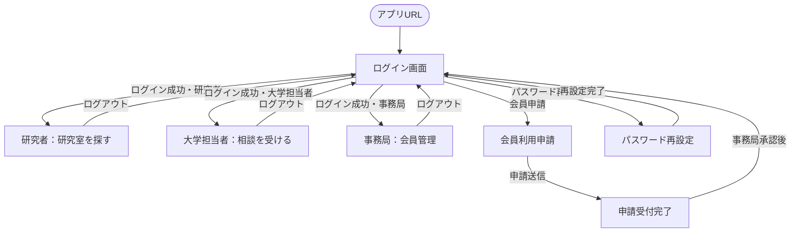
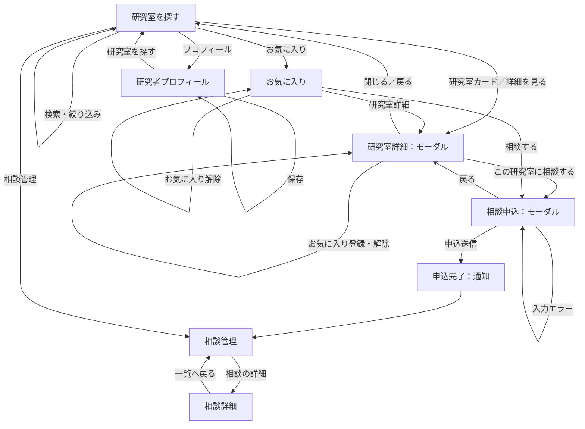
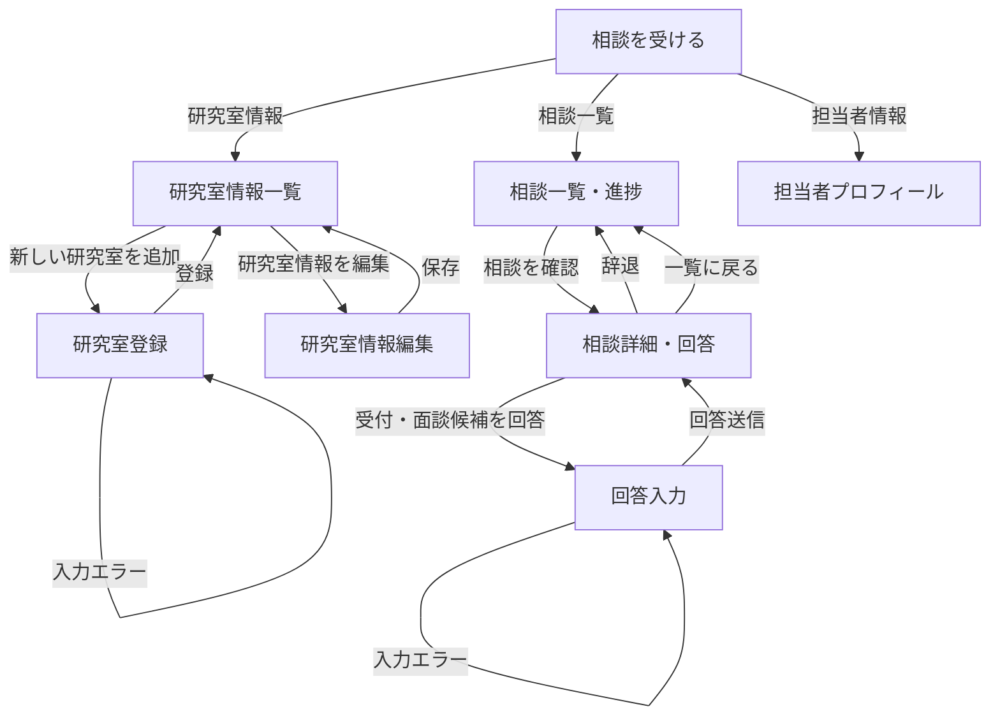
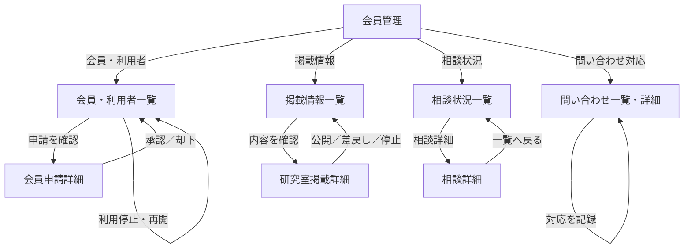

# 博士進学マッチ 画面遷移図

## 1. 対象と前提

モックアップの画面構成を基に、研究者、大学担当者、コンソーシアム事務局の遷移を示す。各役割はログイン後に自分の権限に対応するナビゲーションを利用する。画面遷移図の「画面」は、ページ全体の切替だけでなく、モーダルの表示も含む。

## 2. 共通・ログイン前後

## 3. 研究者の画面遷移

## 4. 大学担当者の画面遷移

## 5. 事務局の画面遷移

## 6. 遷移・権限制御ルール

- ログイン成功後は、アカウントに設定された役割のトップ画面を表示する。画面上の役割切替はモックアップ用であり、本番では利用者自身が権限を切り替えられない。
- 研究者が相談申込みを送信すると、相談管理に遷移し、送信した相談が一覧の先頭に表示される。
- 研究室詳細・相談申込のモーダルは、閉じる操作または背景クリックで閉じられる。入力中に閉じる場合は、未送信内容が失われる旨を確認する仕様を推奨する。
- 相談申込では、必須項目・入力形式・プロフィール共有同意を確認し、問題がある場合は同じ画面にエラーを表示する。
- 大学担当者は自大学・担当研究室に届いた相談だけを表示・回答できる。研究者は自分が送信した相談だけを表示できる。
- 事務局の承認・公開停止・利用停止などの操作は、実行者と日時を記録する。
- 権限のない画面URLへ直接アクセスした場合は、権限エラー画面または利用可能なトップ画面へ戻す。

## 7. 画面一覧

| ID | 画面 | 利用者 | 主な遷移元 |
|---|---|---|---|
| C01 | ログイン | 全利用者 | アプリURL、ログアウト |
| C02 | 会員利用申請 | 未登録者 | ログイン |
| C03 | パスワード再設定 | 全利用者 | ログイン |
| R01 | 研究室を探す | 研究者 | ログイン |
| R02 | 研究室詳細（モーダル） | 研究者 | 検索結果、お気に入り |
| R03 | 相談申込（モーダル） | 研究者 | 研究室詳細、お気に入り |
| R04 | お気に入り | 研究者 | 研究者ナビゲーション |
| R05 | 相談管理・相談詳細 | 研究者 | 研究者ナビゲーション、申込完了 |
| R06 | 研究者プロフィール | 研究者 | 研究者ナビゲーション |
| U01 | 相談を受ける | 大学担当者 | ログイン |
| U02 | 相談一覧・詳細・回答 | 大学担当者 | 大学担当者ナビゲーション |
| U03 | 研究室情報一覧・登録・編集 | 大学担当者 | 大学担当者ナビゲーション |
| U04 | 担当者プロフィール | 大学担当者 | 大学担当者ナビゲーション |
| A01 | 会員・利用者管理 | 事務局 | ログイン |
| A02 | 掲載情報管理 | 事務局 | 事務局ナビゲーション |
| A03 | 相談状況管理 | 事務局 | 事務局ナビゲーション |
| A04 | 問い合わせ対応 | 事務局 | 事務局ナビゲーション |
